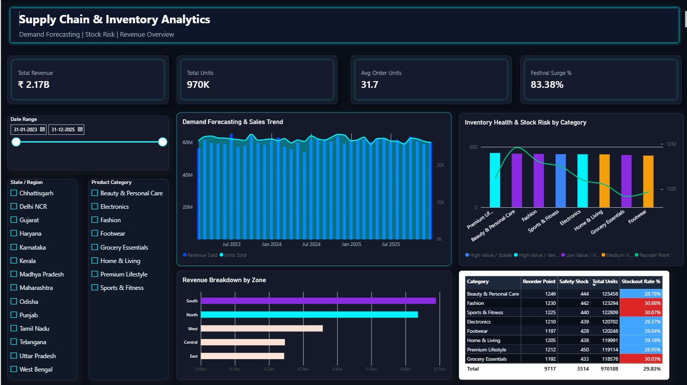

# Supply Chain & Inventory Analytics System

A comprehensive supply chain data analytics solution featuring an interactive Power BI executive dashboard, Python-based inventory optimization, and DAX-driven risk monitoring.



## 📌 Project Overview
This project addresses stockout risks, safety stock levels, and demand forecasting across multi-regional distribution networks. It provides executive visibility into core performance indicators including Total Revenue, Unit Distribution, and Category-level Inventory Health.

## 🔑 Key Features & Insights
* **Executive Dark Glassmorphic Dashboard:** Built with custom neon visual branding and scannable visual layout.
* **Stockout Risk Automation:** Applied dynamic DAX conditional formatting to instantly flag category stockout rates exceeding **30%** (specifically identifying high-risk categories in *Fashion*, *Sports & Fitness*, and *Grocery Essentials*).
* **Demand & Zone Analysis:** Evaluates revenue performance across 5 key geographic zones, highlighting top revenue drivers in the *South* and *North* regions.

## 🛠️ Project Structure
```text
SUPPLY CHAIN & INVENTORY ANALYTICS/
├── assets/             # Dashboard screenshots and visual media
├── data/               # Excel datasets (ABC/XYZ analysis, ecosystem, & safety stock)
├── notebook/           # Python processing & inventory optimization notebook
├── pbix/               # Power BI project file and DAX measure definitions
├── .gitignore          # Git tracking rules
└── README.md           # Project documentation